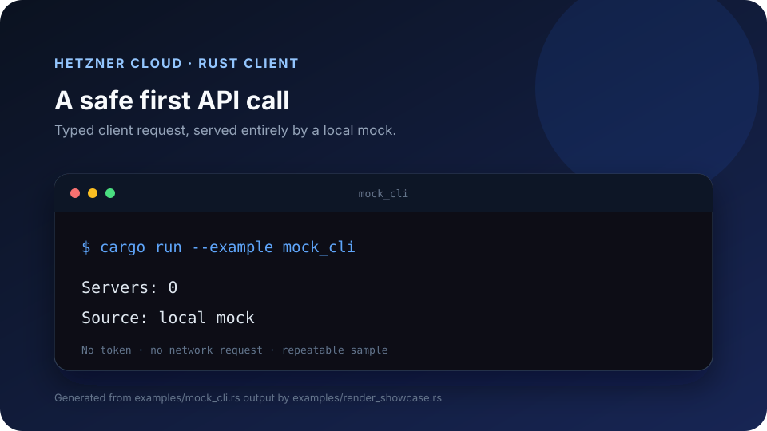

# hetzner-rs

Generated asynchronous and blocking Rust clients provide typed access to the Hetzner Cloud API.



The client is generated from the official OpenAPI document at
<https://docs.hetzner.cloud/cloud.spec.json> by
[Oxide Computer Company's Progenitor](https://github.com/oxidecomputer/progenitor).

## Licensing

Original code in this repository is licensed under the MIT license; see
[LICENSE](LICENSE). Hetzner's OpenAPI document has no `info.license` field and
its hosting page grants no explicit license; the vendored specification and the
material generated from it remain subject to Hetzner's terms. See
[NOTICE](NOTICE).

## API coverage

The generated client includes operations tagged for servers, server types,
locations, images, SSH keys, networks, firewalls, primary IPs, pricing, and
actions. The OpenAPI 3.1 source is checked in at `spec/cloud.spec.json`, and
`spec/REVISION` records its SHA-256, short revision, fetch date, and the
pinned generator.

`tools/generate` is a small Rust binary that downconverts the snapshot to the
scoped OpenAPI 3.0.3 document in `spec/cloud.openapi-3.0.json` (type arrays
become `nullable`/`anyOf`, `const` becomes a one-value `enum`, schema
`examples` arrays become `example`, numeric exclusive bounds become booleans),
then runs Progenitor 0.15.1 and formats `src/client.rs`. Regenerate from the
vendored snapshot with:

```sh
cargo run --locked --manifest-path tools/generate/Cargo.toml
cargo test --locked --manifest-path tools/generate/Cargo.toml
```

## Regeneration and releases

`scripts/regen` checks for a new upstream spec, then regenerates and releases
it. It runs standalone on a Linux host and does not use GitLab CI. Working
in a temporary worktree of `origin/main`, it:

1. downloads the spec and compares its SHA-256 with `spec/REVISION`, exiting
   0 if nothing changed;
2. regenerates with the pinned Progenitor and runs `cargo fmt --check`,
   Clippy with `-D warnings`, and the tests for the crate and the generator;
3. chooses the next version against the latest `v*` tag: patch if `src/` is
   unchanged, minor if `cargo-semver-checks` (pinned, installed into
   `~/.cache/hetzner-rs-regen`) passes, and major if it reports a break;
4. writes the selected numeric semver to `Cargo.toml` and `Cargo.lock`, then
   commits to `main`, tags `v<semver>+api.<revision>`, and pushes both
   atomically. Cargo's package version is the numeric `<semver>` portion of
   the Git tag; `+api.<revision>` is Git tag metadata and is not part of the
   Cargo package version. Existing tags are historical and are not moved.

`--dry-run` stops before the commit, tag, and push. `--force` regenerates
even when the hash matches, and `--spec-file FILE` uses a local file instead
of downloading. If a step fails, the script prints that step and exits
nonzero. When `GITLAB_TOKEN` is set and `glab` is installed, it also opens an
issue. A systemd timer runs it on the scheduled regen host, for example:

```ini
# hetzner-rs-regen.service
[Service]
Type=oneshot
WorkingDirectory=%h/src/hetzner-rs
ExecStart=%h/src/hetzner-rs/scripts/regen
```

GitLab CI only checks formatting, Clippy, tests, and docs. Nothing is
published to crates.io; consumers depend on the release tags.

## Install

Not published to crates.io. Add the crate as a Git dependency pinned to a release tag:

```toml
[dependencies]
hetzner-rs = { git = "https://github.com/davidawad/hetzner-rs", tag = "v0.1.0+api.0f7f538a1d76" }
```

The tag format is `v<ver>+api.<rev>`. On the next generated release,
`scripts/regen` updates the crate package version to `<ver>` before committing
that tag.

Run the checked-in mock-backed CLI example locally with:

```sh
cargo run --example mock_cli
```

```text
Servers: 0
Source: local mock
```

The example starts a loopback HTTP mock and never contacts Hetzner Cloud.

## Usage

The generated API is asynchronous:

```rust,no_run
use hetzner_rs::client::Client;

# async fn example() -> Result<(), Box<dyn std::error::Error>> {
let client = Client::new("https://api.hetzner.cloud/v1");
let servers = client.list_servers(None, None, None, None, None, None).await?;
println!("{}", servers.into_inner().servers.len());
# Ok(())
# }
```

For blocking applications, `SyncClient` stores its API token in a redacted
`Secret`, marks the authorization header sensitive, and executes generated
calls on one process-wide Tokio runtime. Its `call` method retries 429 and 5xx
responses with capped exponential backoff only when given an idempotent HTTP
method (GET, HEAD, PUT, DELETE, or OPTIONS). POST, PATCH, and other methods
return those errors without retrying. The method argument must match the
generated operation in the closure. Blocking methods must not be called from
inside a Tokio task.

```rust,no_run
use hetzner_rs::{Secret, SyncClient};

# fn example() -> Result<(), Box<dyn std::error::Error>> {
let client = SyncClient::new(Secret::new(std::env::var("HCLOUD_TOKEN")?))?;
let response = client.call(hetzner_rs::HttpMethod::Get, |api| Box::pin(api.list_servers(None, None, None, None, None, None)))?;
println!("{}", response.into_inner().servers.len());
# Ok(())
# }
```

Tests use checked-in response fixtures and local loopback mocks; none call the
live API. CI runs formatting, Clippy with warnings denied, tests, and
documentation builds.
